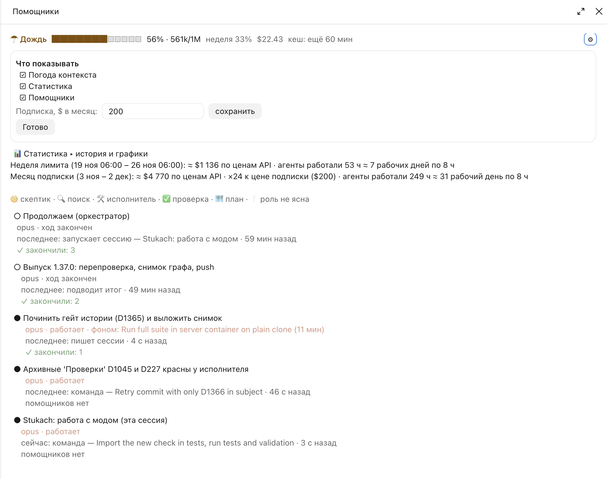
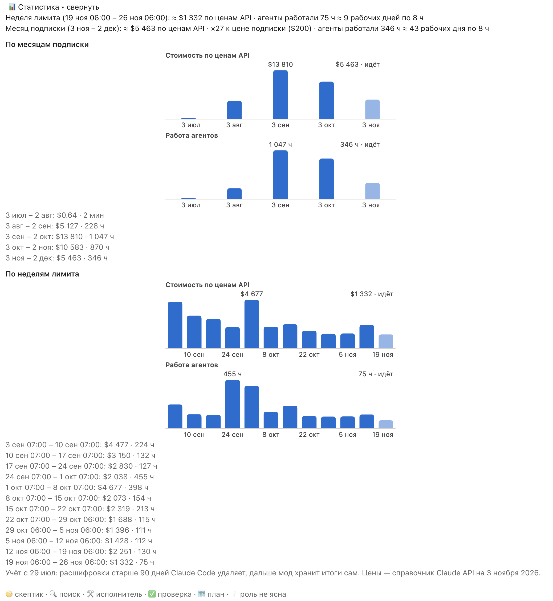

# Stukach — панель «Помощники» для Claude Code



Мод для [Claude Code](https://code.claude.com) (вкладка Code в приложении Claude): панель рядом с чатом. В ней видно, сколько стоила бы ваша работа по ценам API, сколько часов на вас отработали агенты, насколько заполнен контекст и кто из сессий и помощников работает прямо сейчас.

## Сколько вы экономите

Подписка Claude — фиксированная плата, и по ней не видно, сколько работы она покупает. Stukach считает по расшифровкам всех ваших сессий и их помощников, во что та же работа обошлась бы по ценам Claude API и сколько часов агенты проработали вместо вас:

> Месяц подписки (3 ноя – 2 дек): ≈ $4 770 по ценам API · ×24 к цене подписки ($200) · агенты работали 249 ч ≈ 31 рабочий день по 8 ч



Строка выше — за месяц подписки, от дня оплаты. Рядом такая же строка за текущую неделю лимита, от сброса до сброса недельного окна. Нажатие на «📊 Статистика» раскрывает историю по месяцам и неделям с графиками стоимости и часов. Так видно, какая неделя была самой дорогой и как растёт отдача от подписки.

## Погода контекста и остывший кеш


Первая строка панели — погода этой сессии, перенесённая из мода [context-weather](https://github.com/Nugnii/mod-weather). Чем ближе контекст к пределу, тем «хуже погода» («☀ Ясно» … «⚠ Пора сжимать»). Рядом токены, израсходованные лимиты «5ч» и «неделя», стоимость сессии по оценке `/cost` и сколько ещё проживёт кеш.

Claude держит прочитанный диалог в кеше 5 минут или час. Вернулись к длинной сессии через полтора часа — кеш остыл, и следующее сообщение заново прочитает весь диалог по полной цене записи в кеш. Stukach не даёт отправить такое сообщение вслепую. Первое нажатие Enter его придерживает, а над полем ввода появляется карточка:

> Кеш, скорее всего, остыл: с последнего ответа прошло 61 мин. Это сообщение заново прочитает весь диалог, около 430k токенов — это ≈ $3.44 по ценам API (с тёплым кешем было бы $0.086). Нажмите Enter ещё раз, чтобы отправить.

Второй Enter в течение двух минут отправляет. Команды и сообщения с картинками проходят сразу. На подписке та же сумма уходит не деньгами, а долей лимитов «5ч» и «неделя».

Если включён и сам context-weather, Enter придерживает только он, а Stukach уступает: хватает двух нажатий. Строк погоды тогда две — над полем ввода и в панели; лишнюю в панели снимает галочка «Погода контекста».

## Помощники

Для работы в режиме оркестратора, когда одна сессия запускает другие, а внутри них трудятся помощники:

- сверху сессия-оркестратор, под ней каждая запущенная ею сессия, под каждой сессией её помощники;
- у помощника видна роль значком (🧐 скептик, 🔍 поиск, 🛠 исполнитель, ✅ проверка, 🗺 план, ❔ роль не ясна), модель (opus, sonnet, haiku), что он делает сейчас или сделал последним, и состояние: работает или ждёт разрешения;
- помощники волн (инструмент Workflow) стоят под своей волной: «🌊 волна «имя» · идут 3 из 12»;
- закончивший помощник из списка уходит сразу, под сессией остаётся одна строка «✓ закончили: N»;
- нажатие на название сессии открывает её в приложении (на Mac).

## Настройки и как открыть

Шестерёнка ⚙ справа от погоды открывает галочки «Погода контекста», «Статистика», «Помощники» и цену подписки (по умолчанию $200 в месяц). Настройки общие для всех окон; галочка «Погода контекста» выключает и строку, и придержку Enter.

Пока панель закрыта, над полем ввода стоит кнопка «👥 Помощники» — она открывает панель. Ещё её открывает команда `/stukach`.

### Как считается статистика

- **Деньги** — по каждому ответу модели из расшифровок сессий и помощников: вход, запись в кеш (×1,25 на 5 минут, ×2 на час), чтение кеша и выход по прейскуранту Claude API на 3 ноября 2026. Быстрый режим — вдвое. Это оценка «сколько бы вы заплатили по API», а не счёт: на подписке эти токены входят в её лимиты.
- **Время** — паузы внутри хода каждой сессии и каждого помощника, сложенные: три помощника, работавшие час одновременно, — это 3 часа. Не считаются: ожидание вас между ходами, ожидание ответа на вопрос, ожидание своего помощника (его время уже в его файле). Пауза внутри хода длиннее 15 минут считается как 15 минут.
- **Неделя лимита** — по дате сброса недельного окна, которую присылает API; без подписки — последние 7 дней. **Месяц подписки** — с дня оплаты из учётки Claude Code.

Первый подсчёт проходит всю историю расшифровок фоном и занимает несколько минут; панель пишет «считаю историю: N%». Дальше дочитывается только новое. Итоги по часам мод хранит сам в `~/.claude/stukach/stats.json`: Claude Code удаляет расшифровки старше 90 дней, а итоги остаются. Ведёт учёт одно окно, остальные читают готовый файл.

## Установка

В терминале, в строке ввода Claude Code:

```
/plugin install stukach --marketplace Nugnii/Stukach
```

Из оболочки:

```
claude plugin install stukach --marketplace Nugnii/Stukach
```

В приложении Claude, где `/plugin` не работает: нажмите + рядом с полем ввода, затем Plugins, Add marketplace с адресом `Nugnii/Stukach`, затем Add plugin.

В уже открытой сессии панель появится после `/reload-plugins`, в новых сессиях — сама.

## Пределы

- Семья сессий ищется среди сессий всех проектов на этом компьютере за последние сутки: оркестратор и запущенные им сессии обычно работают в разных папках.
- В одной группе (помощники сессии, одна волна) строк работающих помощников не больше 8, остальные — числом: «…и ещё работают: N».
- Переход по нажатию на название сессии работает на Mac: мод открывает ссылку приложения командой `open`.
- Статистика видна с самой старой сохранённой расшифровки; что Claude Code удалил до установки мода, уже не посчитать.
- Цены зашиты в мод и обновляются вместе с ним; модель не из прейскуранта считается отдельной строкой «ответов без цены». Время кеша в погоде — оценка мода, отсюда «скорее всего» в предупреждении.
- «Ждёт разрешения» видно точно в тех сессиях, где мод загружен. Для сессии без мода панель пишет «ответа нет N мин, возможно, ждёт разрешения».
- Мод читает только файлы на этом компьютере: расшифровки сессий Claude Code, записи приложения о сессиях и учётку Claude Code (дату начала подписки). Наружу он ничего не отправляет.

## Проверка

```
claude plugin validate <папка мода>
claude plugin test <папка мода>
```
